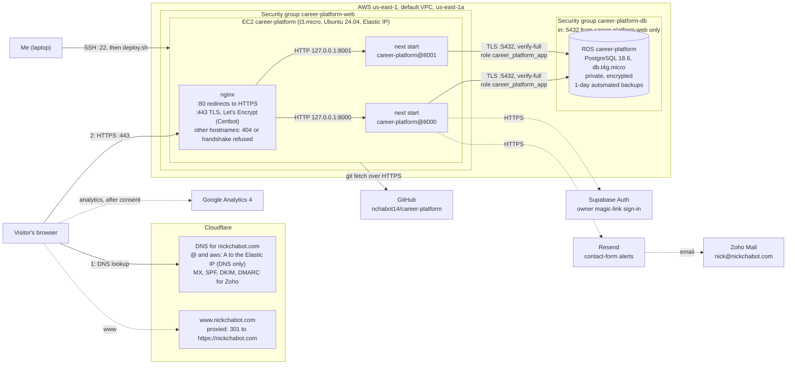

# career-platform

A recruiter-first resume site with a private owner dashboard, built with
Next.js App Router, TypeScript, Tailwind CSS, Drizzle ORM, and PostgreSQL.

**Live:** <https://nickchabot.com>, on AWS: one EC2 instance runs the app,
and Amazon RDS runs the PostgreSQL database. The site moved there from
Railway on 2026-11-10; the full record is in
[migration-notes.md](migration-notes.md).

Project 1 evidence: [docs/project-1-submission.md](docs/project-1-submission.md).

- **Public site:** profile, experience, projects (each with its own page),
  skills, education, links, a Resume PDF download, and a contact form.
  Only published content is shown. Projects are read from the database on
  every request. If the database fails, the homepage still shows the
  profile, says "Projects temporarily unavailable." and returns HTTP 503.
  A refresh after the database recovers brings the projects back
  ([evidence](docs/evidence/database-outage.md)).
- **Owner dashboard (`/admin`):** edit, order, publish, and preview content;
  upload the resume PDF; read contact messages; track job applications with
  contacts, documents, and a status timeline. Sign-in uses Supabase magic
  links and admits only `OWNER_EMAIL`.

## Requirements

- Node.js 24
- pnpm 11.24.0

## Local setup

1. Install dependencies:

   ```bash
   pnpm install
   ```

2. Create your local environment file:

   ```bash
   cp .env.example .env.local
   ```

   The public site works with no changes. `/admin` needs the Supabase values
   and `OWNER_EMAIL`; contact-form email alerts need the Resend values. See
   [docs/operations.md](docs/operations.md#environment-variables).

3. Start the local PostgreSQL database and apply the migrations:

   ```bash
   docker compose up -d --wait
   pnpm db:migrate
   ```

   Docker creates `career_platform` plus the `career_platform_test` and
   `career_platform_e2e` databases the tests use. Stop it with
   `docker compose down`; add `-v` to delete its data.

4. Start the development server:

   ```bash
   pnpm dev
   ```

## Database commands

- `pnpm db:generate`: create a migration after editing `lib/db/schema.ts`
- `pnpm db:migrate`: apply pending migrations

## Quality commands

- `pnpm lint`
- `pnpm typecheck`
- `pnpm test`: unit tests
- `pnpm test:integration`: repository and route tests against the
  `career_platform_test` database
- `pnpm test:e2e`: Playwright browser and accessibility tests. They build the
  app and run it on port 3100 against the throwaway
  `career_platform_e2e` database. Run `pnpm exec playwright install chromium`
  once first.

## How the site runs

The site runs on AWS in `us-east-1`. Everything is named `career-platform`
and tagged `Project=career-platform`.

- **EC2 instance `career-platform`:** a t3.micro (2 vCPU, 1 GiB, plus 2 GiB
  of swap) running Ubuntu 24.04, with an Elastic IP.
  - **nginx** ends HTTPS, using a Let's Encrypt certificate from Certbot that
    renews automatically.
  - nginx forwards each request to one of **two copies of `next start`**,
    the systemd units `career-platform@8000` and `@8001`. They listen only on
    `127.0.0.1` and run as the unprivileged user `career-platform`.
  - If one copy is down, nginx sends the request to the other.
- **RDS instance `career-platform`:** PostgreSQL 18.6 on a db.t4g.micro,
  Single-AZ, with encrypted storage. It has no public address.
  - The app connects as `career_platform_app`, which can read and write rows
    but can't change the schema. Migrations run as `career_platform_admin`.
  - Every connection uses TLS with the certificate checked
    (`sslmode=verify-full`, with Amazon's CA bundle given through
    `NODE_EXTRA_CA_CERTS`).
- **Security groups:**
  - `career-platform-web` allows 80 and 443 from anywhere, and 22 only from
    my IP.
  - `career-platform-db` allows 5432 only from `career-platform-web`.
- **DNS:** in Cloudflare, `nickchabot.com` and `aws.nickchabot.com` are `A`
  records for the Elastic IP, DNS only.

The setup files live in [`deploy/aws/`](deploy/aws): the systemd unit, the
nginx site, `deploy.sh`, and the app role's SQL.
`tests/unit/aws-deploy-config.test.ts` pins the properties they must keep.

**Updating the site** means SSH to the instance and run:

```bash
sudo -u career-platform git -C /srv/career-platform/repo pull --ff-only
sudo /srv/career-platform/repo/deploy/aws/deploy.sh main
```

`deploy.sh` checks out the commit into a new `releases/<sha>-<time>`
directory and builds it there. Only after a successful build does it run
`node scripts/migrate.mjs`, point `/srv/career-platform/current` at the new
release, and restart the two copies one at a time. If either copy fails
`/api/health`, it points `current` back to the previous release. A failed
build changes nothing that's live. A deploy takes about 3–8 minutes on the
t3.micro, and the last 3 releases are kept.

- **Schema changes:** `pnpm db:generate` locally, then commit the migration
  in `drizzle/` and deploy. Deploys never seed data. Migrations stay applied
  even if a deploy rolls back, so each one must keep working with the
  previous release (add columns and tables; drop them only in a later
  release).
- **Settings:** in `/srv/career-platform/shared/.env` (mode 600), which is
  linked into each release. The admin database URL is in a separate
  `shared/migrate.env` that only `deploy.sh` reads. `NEXT_PUBLIC_*` values are
  built into the app, so after changing one, redeploy.
- **Logs and status:**
  - `systemctl status 'career-platform@*'`
  - `journalctl -u 'career-platform@*'` (kept 14 days)
  - `/var/log/nginx/` (rotated, 14 days)
  - `curl https://nickchabot.com/api/health`
- **Restarts:** systemd restarts a crashed copy, and every service starts at
  boot. After a reboot the site was back in 25 s. EC2's simplified automatic
  recovery moves the instance if its host fails.

**Who manages what.** AWS runs the hardware and the network, and RDS takes
care of the database engine: patching, storage, automated backups and
point-in-time restore. I'm responsible for everything on the instance:
Ubuntu, Node, nginx, Certbot, systemd, deploys and security updates
(unattended-upgrades is on). I also own the security-group rules, the
settings and secrets, the schema and data, DNS, and testing. This split is
why I chose EC2 with RDS: I run a real server and learn from it, but I don't
have to look after the database.

The data moved from a verified `pg_dump` of Railway's database. The RDS copy
was compared with it table by table, using row counts and a hash of every
row, and all 14 tables match. How it went, including the 23 places where the
work differed from the plan and the verification table, is in
[migration-notes.md](migration-notes.md).

### Railway (history)

The site ran on Railway from 2026-10-26 to 2026-11-10: a web service built
from the `Dockerfile` and a Railway PostgreSQL 18 service. In practice, it
served nickchabot.com only briefly:
- Its certificate wasn't issued for days because of a Railway incident.
- From 2026-10-26 the web service failed to start, because the Supabase
  variables were never set.
- Railway shut its PostgreSQL service down on 2026-11-08.

GitHub deploys from `main` were turned off on 2026-11-10, before the AWS
branch was merged. How the earlier move went is in
[docs/railway-migration.md](docs/railway-migration.md).

### Azure (history)

The site ran on an Azure VM until 2026-10-26. Its setup, backups and
restore steps are in [docs/operations.md](docs/operations.md). The nginx,
two app copies, NSG rules and reboot check are in
[docs/superpowers/plans/2026-10-01-operate-the-vm.md](docs/superpowers/plans/2026-10-01-operate-the-vm.md),
and its HTTPS setup is in
[docs/how-this-site-is-secured.md](docs/how-this-site-is-secured.md). The
AWS setup reuses the same pattern (nginx, two systemd copies, Certbot) and
adds a managed database.

## Architecture



Solid lines are the request and deploy paths; dashed lines are optional or
third-party traffic. Both app copies call Supabase and Resend; the diagram
draws those calls from one copy to keep it readable. Supabase and Resend
need values in `shared/.env`, which aren't set yet (see
[Remaining limitations](#remaining-limitations)).

A request works like this:
1. Cloudflare DNS returns the Elastic IP. Cloudflare only answers the DNS
   query; it doesn't proxy the site.
2. The browser opens HTTPS to nginx on the instance.
3. nginx ends TLS and sets `X-Real-IP` and `X-Forwarded-For` to the real
   client address, overwriting anything the client sent. The contact-form
   rate limit relies on that.
4. nginx forwards the request to either copy of the app.
5. The app reads RDS over TLS, inside the VPC, and builds the page.

`www` never reaches AWS: Cloudflare answers it with a 301. Mail goes to Zoho
through the MX records, whatever host runs the site. Visitors' browsers send
analytics straight to Google, and only after they consent.

Earlier diagrams for Azure and Railway, with the email and analytics paths
in detail, are in [docs/request-path.md](docs/request-path.md).

## Rollback

**Code.** The last 3 builds stay in `/srv/career-platform/releases/`, and
`deploy.sh` already rolls back by itself if a new release fails its health
check.
- **Fastest**, with no rebuild: point `current` at an earlier release and
  restart both copies.

  ```bash
  sudo ls -t /srv/career-platform/releases
  sudo -u career-platform ln -sfn /srv/career-platform/releases/<dir> /srv/career-platform/current
  sudo systemctl restart career-platform@8000 career-platform@8001
  ```

- **Lasting:** `git revert <sha>`, push to `main`, and deploy, so `main`
  matches what's running.

**Database.** Migrations in `drizzle/` only go forward, and they run during
each deploy. So:
- **Before deploying a change that adds a migration, take a snapshot**
  from the laptop:

  ```bash
  aws rds create-db-snapshot --db-instance-identifier career-platform \
    --db-snapshot-identifier career-platform-before-<change>
  ```

- **To undo a schema change,** write a new migration that reverses it and
  deploy that. Rolling the code back leaves the new schema in place, so old
  code has to tolerate it.
- **If data is damaged,** restore a snapshot, or a point in time within the
  last day, to a **new** RDS instance. Compare row counts with
  `scripts/db-fingerprint.sql`, then point `DATABASE_URL` and
  `migrate.env` at it and redeploy. RDS can't restore over an existing
  instance. Snapshots so far: `career-platform-after-cutover`
  (2026-11-10). The 2026-10-29 `pg_dump` is kept off-repo.

**Hosting.** There's no warm fallback anymore. Railway's database was shut
down on 2026-11-08 and its deploys are off. The Azure VM, if it's still
running (not checked since 2026-10-26), has only the older SQLite-era copy
of the site. To recover from losing the instance:
1. Launch a new t3.micro.
2. Follow Tasks 4–6 of the
   [AWS plan](docs/superpowers/plans/2026-11-10-aws-ec2-rds-migration.md).
   The data is safe in RDS.
3. Move the Elastic IP to the new instance, so DNS doesn't need to change.

## Decisions

Written up on 2026-10-26 from the repository and what happened, and
checked by me against my own reasons.

1. **SQLite first, then PostgreSQL.** I used SQLite on the Azure VM
   because the course's Azure guide called for it; I didn't compare engines
   myself at the time. Looking back, it fit that setup: the database is one
   file next to the app, there's no database server to install, secure or
   keep running, it's read locally rather than over the network, and a
   backup is one `.backup` command. Running PostgreSQL on the VM would have
   meant another service competing with the app for the VM's 1 GiB of
   memory. The limit showed up at the next move: a SQLite file lives on one
   machine's disk, and Railway runs the app in a container with no lasting
   disk, so moving to Railway meant moving to PostgreSQL. (Commit `1405773`,
   2026-10-01.)
2. **Moving from the VM to Railway.** Alternatives: stay on the VM, or
   move to another PaaS. I'd move, because our time is the biggest cost and
   Railway takes over the server, TLS and deploys. The full reasoning is in
   the [recommendation](docs/railway-migration.md#recommendation).
3. **Managed email (Zoho) instead of running a mail server.** Running
   Postfix and Dovecot on the VM was the alternative. It would mean keeping
   port 25 open, spam filtering, TLS certificates for mail, and building a
   sending reputation from a cloud IP address, which large providers often
   distrust (Azure also restricts outbound port 25). Zoho's free plan
   handles all of that; I publish MX, SPF, DKIM and DMARC records and keep
   control of the domain, so I can switch providers by changing DNS. The
   cost is depending on Zoho's free-plan limits.
4. **Moving from Railway to AWS, with EC2 and RDS.** I compared three
   options:
   - EC2 with PostgreSQL on the same instance: the cheapest and the
     quickest to deploy.
   - EC2 with RDS: the middle option on cost.
   - Lambda with API Gateway and RDS: the least to operate, but the app
     would need changes. Next.js would need an adapter, Lambda's 6 MB
     payload limit would break 10 MiB uploads, and the in-memory rate
     limit wouldn't work. It would also cost the most at this traffic,
     about $50–70 a month, because of the NAT gateway and RDS Proxy.

   I chose **EC2 with RDS** to learn how to run a server while leaving
   backups and patching of the database to AWS. The course's AWS policy
   allows only t3.micro or t3.small instances, and I picked the
   **t3.micro** to save about $8 a month. The cost is slower builds on
   1 GiB of memory, made safe with swap and a build that happens before
   the switch. (2026-10-29 to 2026-11-10; see
   [migration-notes.md](migration-notes.md).)

## Investigated failures

| Failure | Kind | Record |
|---|---|---|
| The SQLite database the app expected didn't exist, then held no data | Application/database dependency, real | [ex03.md](docs/evidence/ex03.md#the-sqlite-database-i-expected-didnt-exist) |
| First Railway deploy served `relation "profile" does not exist`: the pre-deploy migration never ran because Railway ignored `railway.json` | Application/database dependency, real | [railway-migration.md](docs/railway-migration.md#problems-along-the-way) |
| Railway's certificate for nickchabot.com not issued after the cutover | Network/TLS, real; Railway had issued it by 2026-11-10, after the site had moved on | [domain-and-https.md](docs/evidence/domain-and-https.md#investigation-railway-certificate-not-issued) |
| Railway's PostgreSQL shut down on 2026-11-08, so no fresh dump was possible before the AWS cutover | Hosting/data, real | [migration-notes.md](migration-notes.md#what-went-wrong-and-how-it-was-handled) (#2) |
| After Certbot added HTTPS, `https://<Elastic IP>/` served the site to any hostname | Network/TLS, real, fixed with a default server that refuses the handshake | [migration-notes.md](migration-notes.md#what-went-wrong-and-how-it-was-handled) (#6) |
| `deploy.sh` would have rebuilt inside the live release when redeploying the same commit | Deployment, real, found before it caused harm | [migration-notes.md](migration-notes.md#what-went-wrong-and-how-it-was-handled) (#5) |
| AWS Free plan refused 7-day RDS backups (`FreeTierRestrictionError`) | Cloud account limit, real | [migration-notes.md](migration-notes.md#what-went-wrong-and-how-it-was-handled) (#1) |
| DNS still at the old VM, so the old certificate didn't match | DNS/TLS, **supplied lab simulation** | [ex05.md](docs/evidence/ex05.md) |
| Azure region refused by the student subscription; wrong IP in the plan | Azure setup, real | [ex03.md](docs/evidence/ex03.md#what-went-wrong-and-how-i-fixed-it) |

Each record gives the symptom, the checks, the diagnosis, the repair, and
the repeated check.

## Remaining limitations

As of 2026-11-10:

- **No `/admin` sign-in or contact email alerts yet.** The Supabase,
  `OWNER_EMAIL` and Resend values in `shared/.env` are still empty, so
  `/admin` returns 500. Contact messages are still saved. Once the values
  are filled in, I'll need to redeploy and check Supabase's Site URL and
  redirect list.
- **No resume is uploaded,** so `/resume` returns 404; uploading needs
  `/admin`.
- **RDS keeps automated backups for 1 day only.** The account is on AWS's
  Free plan, which refused 7. Longer recovery relies on manual snapshots
  and `pg_dump` files.
- **One instance in one Availability Zone.** The two app copies survive a
  crash of either one, but not the loss of the instance or of
  `us-east-1a`.
- **No alerting yet.** The course account can't create CloudWatch alarms,
  and the uptime monitor on `/api/health` isn't set up yet.
- **Security updates and the server itself are mine.** unattended-upgrades
  installs patches, but kernel updates need a reboot that nothing
  schedules.
- **The database outage check ran on a local build**, not on AWS.
- **The fallback profile is a copy** (`lib/fallback-profile.ts`), so it has
  to be updated by hand when the profile or education changes.
- **The health check doesn't cover the schema:** it only checks that the
  database answers, so a deploy with missing tables can still go live.
- **Some docs still describe old hosts:**
  - [docs/operations.md](docs/operations.md) describes Azure.
  - The privacy page names Microsoft Azure and still has two `[CONFIRM]`
    notes.
  - `railway.json` is no longer used.

  Task 9 of the
  [AWS plan](docs/superpowers/plans/2026-11-10-aws-ec2-rds-migration.md)
  updates these, no sooner than 2026-11-13.

## Services, costs and cleanup

| Service | What it's for | Billing | Cost so far | Ends or renews | Cleanup |
|---|---|---|---|---|---|
| AWS EC2 `career-platform` (t3.micro, standard CPU credits) + 20 GB gp3 disk | Runs the site | On-demand by the hour, on the course's Free-plan account | Not visible to me: the course login can't read billing | Until course access ends (to confirm with the instructor) | Terminate the instance; the disk is deleted with it |
| AWS Elastic IP | The site's fixed address | $0.005/hr, billed whether the instance runs or not | Same | Same | Disassociate and **release** it, or it keeps billing |
| AWS RDS `career-platform` (db.t4g.micro, Single-AZ) + 20 GB gp3 | The database | By the hour, plus storage. Backups are free up to 100% of the database storage | Same | Same | Turn off deletion protection, delete with a final snapshot, then delete subnet group `career-platform` and the two security groups |
| AWS RDS snapshot `career-platform-after-cutover` | Restore point | Free within the backup allowance | Same | Kept until deleted | Delete when no longer needed |
| **AWS total (estimate)** | | From AWS's published us-east-1 prices on 2026-11-10: EC2 $7.59, RDS $11.68, storage $3.90, IPv4 $3.65 | | **≈ $26.82 per month** | |
| Railway, project `fabulous-recreation` | Former host (2026-10-26 to 2026-11-10) | Trial: $5 of credit for 30 days | $0.36 for 2026-10-08 to 2026-10-26 (`railway usage`) | Trial ended 2026-11-08; Postgres shut down that day. GitHub deploys turned off 2026-11-10 | Delete the project after 2026-11-13 (Task 9), then remove Cloudflare's `_railway-verify` record |
| Azure VM `vm-career-platform` (Standard_B2ats_v2) | Older host | Azure for Students credit: compute by the hour, plus the OS disk and public IP, which bill even when the VM is stopped | $0.00 billed to me (`az consumption usage list`); the credit balance is in the Azure portal | Runs until the instructor says otherwise | When told: delete resource group `rg-career-platform`, which removes the VM, disk and IP |
| Domain `nickchabot.com` (Namecheap) | The address | Yearly | *Check the Namecheap receipt* | Expires **2027-10-01** | Turn off auto-renew if it's no longer wanted |
| Cloudflare | DNS and the `www` redirect | Free plan | $0 | — | — |
| Zoho Mail | `nick@nickchabot.com` | Forever Free plan | $0 | — | — |
| Google Analytics 4 | Visitor activity | Free | $0 | — | — |
| Supabase | Owner sign-in only (not configured on AWS yet) | Free plan | $0 | Free projects pause when inactive | — |
| Let's Encrypt | HTTPS certificate for `nickchabot.com` and `aws.nickchabot.com` | Free | $0 | Expires 2027-02-08; Certbot renews automatically | — |
| GitHub | Repository and CI | Free | $0 | — | — |

## Specs and plans

- Original application spec:
  [docs/superpowers/specs/2026-10-01-career-platform-design.md](docs/superpowers/specs/2026-10-01-career-platform-design.md)
- Application plan:
  [docs/superpowers/plans/2026-10-01-career-platform.md](docs/superpowers/plans/2026-10-01-career-platform.md)
- Azure VM migration:
  [docs/superpowers/plans/2026-09-24-azure-vm-migration.md](docs/superpowers/plans/2026-09-24-azure-vm-migration.md)
  and [docs/superpowers/plans/2026-10-01-operate-the-vm.md](docs/superpowers/plans/2026-10-01-operate-the-vm.md)
- Railway and PostgreSQL migration:
  [docs/superpowers/plans/2026-10-08-railway-postgres-migration.md](docs/superpowers/plans/2026-10-08-railway-postgres-migration.md).
  There is no separate spec for it; the plan carries the requirements.
- AWS (EC2 + RDS) migration:
  [docs/superpowers/plans/2026-11-10-aws-ec2-rds-migration.md](docs/superpowers/plans/2026-11-10-aws-ec2-rds-migration.md),
  with what actually happened in [migration-notes.md](migration-notes.md).

## Reflection

Something that I understand better is how these requests actually get from a
browser to the app. It is a complicated process where it starts through DNS,
moves through TLS, then hits the proxy, which forwards the request to the
app, and the app builds the page from the information it reads from the
database.

Something that surprised me is how the before-MX email ended up arriving 33
minutes late, rather than bouncing. I thought this email would bounce, but
instead, it just got delayed by a long time before it actually ended up
sending, which is something that I would not have predicted or expected.

Something I'd change is adding the site's real domain after DNS had spread,
rather than before, since I believe that would make the process smoother. I
also would've changed the fact that I did not set all the variables before
the cutover, a good practice to do which I consciously chose not to.
