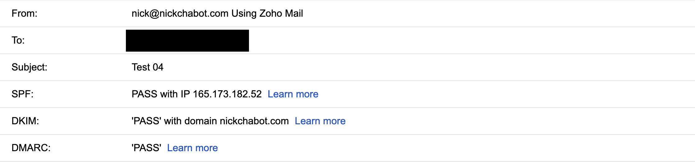
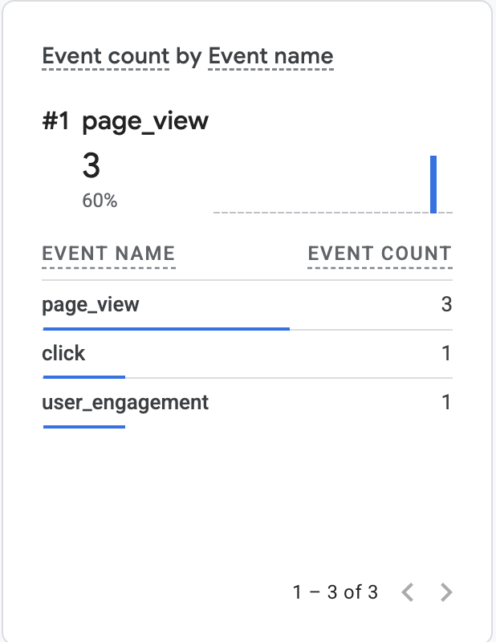
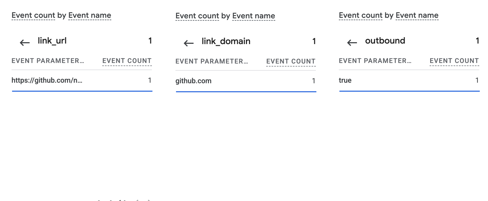

# Exercise 06 Evidence

## 1. Email tests

Mail for `nickchabot.com` runs on Zoho Mail. I tested it on October 20, 2026, with a personal Gmail account as the outside mailbox. Times are PDT and match Zoho's Inbox and Sent folders, checked through the Zoho MCP server.

| Test | Time | Result |
| --- | --- | --- |
| Received a message: "Test 01: Inbound", outside mailbox to `nick@nickchabot.com` | 10:52 AM | Arrived in the Zoho inbox. |
| Replied to it: "Re: Test 01: Inbound", `nick@nickchabot.com` to the outside mailbox | 10:54 AM | Sent from Zoho and arrived in the outside mailbox. |
| Sent a new message: "Test 04", sent by Claude Code through the Zoho MCP server | 11:23 AM | Arrived in the outside mailbox with `nick@nickchabot.com` in From (screenshot below). |

## 2. SPF, DKIM, and DMARC

These are the outside mailbox's (Gmail's) results for the outgoing "Test 04" message, from its "Show original" view:

| Check | Result |
| --- | --- |
| SPF | PASS with IP 165.173.182.52 |
| DKIM | PASS with domain nickchabot.com |
| DMARC | PASS |

*Gmail's authentication results for "Test 04" from `nick@nickchabot.com`; the To address is redacted.*

## 3. GA4

Live site: [nickchabot.com](https://nickchabot.com). Privacy page: [nickchabot.com/privacy](https://nickchabot.com/privacy).

These events were captured from a local run of the site (`http://localhost:3000`), started at 12:58 PM PDT on October 20, 2026, with the screenshots taken at 1:01 PM.

*GA4 recorded 3 `page_view` events, 1 `click`, and 1 `user_engagement` from the local run.*

*The click's details: `link_url` is the project's GitHub link (GA4 shortens it), `link_domain` is `github.com`, and `outbound` is `true`.*

The click tells me a visitor followed a link from my site to GitHub; it doesn't tell me why they clicked or what they did once they got there.

### Check that failed

- **Live site:** I tried to deploy the GA4 tag and Privacy page to Railway, but its builds failed: Railpack detected the repo as Python, and no successful deployment has followed the fix. The live site still runs older code without the tag, and its Privacy page returns 404. Next step: deploy, then repeat this check on https://nickchabot.com.
