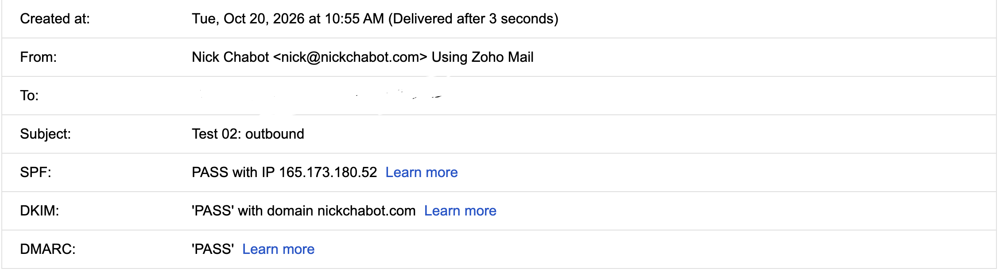

# Exercise 06 Evidence

## Email

Mail for `nickchabot.com` runs on Zoho Mail. I tested it on October 20, 2026, using a personal Gmail account as the outside mailbox.

| Test | Time (PDT) | Observed result | Authentication |
| --- | --- | --- | --- |
| Received a message (Gmail to `nick@nickchabot.com`) | **Missing** | **Not recorded.** No delivery time or inbox evidence saved yet. | **Not shown.** The screenshot covers only Test 02. |
| Replied to that message (`nick@nickchabot.com` to Gmail) | **Missing** | **Not recorded.** No reply time or headers saved yet. | **Not shown.** The screenshot covers only Test 02. |
| Sent a new message (`nick@nickchabot.com` to Gmail, "Test 02: outbound") | 10:55 AM | Arrived in the Gmail inbox. Gmail reported SPF, DKIM, and DMARC all passing for `nickchabot.com`. | SPF: PASS with IP 165.173.180.52. DKIM: PASS with domain nickchabot.com. DMARC: PASS. |



*Gmail's authentication results for Test 02, delivered after 3 seconds. The To address is redacted.*

### Authentication

The excerpt below is from the "Test 02: outbound" headers, as Gmail recorded them on arrival. The full headers are in [zoho-header-check.md](zoho-header-check.md).

```
Received: from sender6-of-o52.zoho.com (sender6-of-o52.zoho.com. [165.173.180.52]) by mx.google.com with ESMTPS ... Tue, 20 Oct 2026 10:55:53 -0700 (PDT)
Authentication-Results: mx.google.com;
       dkim=pass header.i=@nickchabot.com header.s=zmail header.b=oGZD7bug;
       spf=pass (google.com: domain of nick@nickchabot.com designates 165.173.180.52 as permitted sender) smtp.mailfrom=nick@nickchabot.com;
       dmarc=pass (p=NONE sp=NONE dis=NONE) header.from=nickchabot.com
```

| Check | Result | Domain |
| --- | --- | --- |
| SPF | pass | nickchabot.com |
| DKIM | pass (selector `zmail`) | nickchabot.com |
| DMARC | pass (policy `p=none`) | nickchabot.com |

DMARC passed because SPF and DKIM both passed for the same domain as the From address, `nickchabot.com`.

### Missing checks

- **Received test:** I need the time the message arrived in Zoho. A screenshot of the Zoho inbox, or Zoho's "Show original" headers, would cover it.
- **Reply test:** I need the time the reply arrived in Gmail, plus its authentication results from Gmail's "Show original" view.
- **Inbound authentication:** Nothing is saved yet showing how Zoho judged the incoming Gmail message (its `Authentication-Results: mx.zohomail.com` line).
- **Zoho admin console:** No screenshot yet of Zoho's own MX, SPF, and DKIM verification status under Domains > nickchabot.com > Email Configuration.
