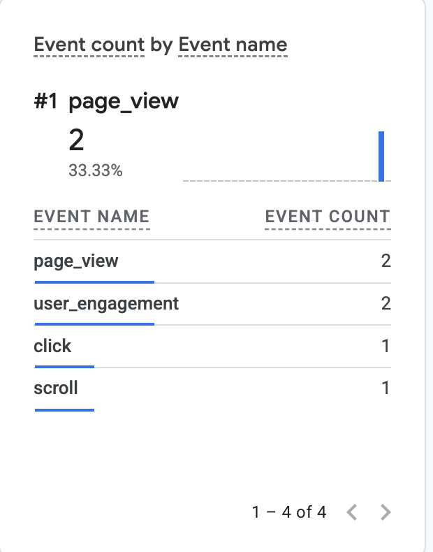

# Exercise 06 Evidence

## 1. Email tests

Mail for `nickchabot.com` runs on Zoho Mail. I tested it on October 20, 2026, with a personal Gmail account as the outside mailbox. Times are PDT and match Zoho's Inbox and Sent folders, checked through the Zoho MCP server.

| Test | Time | Result |
| --- | --- | --- |
| Before any mail record existed: "Test 00: Before Setup", outside mailbox to `nick@nickchabot.com` | Sent 10:33 AM | **Delayed, then delivered.** It didn't arrive when sent: at 10:34 the zone had only the two `A` records and no MX ([dns-before-zoho.md](dns-before-zoho.md)). After the MX records were published (10:42 to 10:44), it arrived in the Zoho inbox at **11:06 AM**, 33 minutes late, and no bounce came back. |
| Received a message: "Test 01: Inbound", outside mailbox to `nick@nickchabot.com` | 10:52 AM | Arrived in the Zoho inbox. |
| Replied to it: "Re: Test 01: Inbound", `nick@nickchabot.com` to the outside mailbox | 10:54 AM | Sent from Zoho and arrived in the outside mailbox. |
| Sent a new message: "Test 04", sent by Claude Code through the Zoho MCP server | 11:23 AM | Arrived in the outside mailbox with `nick@nickchabot.com` in From (screenshot below). |

## 2. SPF, DKIM, and DMARC

These are the outside mailbox's (Gmail's) results for the outgoing "Test 04" message, from its "Show original" view:

| Check | Result |
| --- | --- |
| SPF | PASS with IP 165.173.182.52 |
| DKIM | PASS with domain nickchabot.com |
| DMARC | PASS |

*Gmail's authentication results for "Test 04" from `nick@nickchabot.com`; the To address is redacted.*

**Why Test 00 was late rather than lost.** Times from Zoho's record of the message, checked on October 26 through the Zoho MCP server: sent at 10:33:43 AM, received at 11:06:56 AM PDT. When a domain has no MX record, a sending server falls back to its `A` record, which then pointed at the Azure VM. The VM doesn't accept mail (port 25 isn't open), so delivery failed, and Gmail queued the message to retry; senders keep retrying for days before bouncing. A retry after 10:44 found the new MX record and delivered to Zoho. *This is my explanation from the timing; I didn't see Gmail's delivery attempts.*

### DNS records for mail

Published in Cloudflare on October 20, 2026, all DNS only (mail never goes
through Cloudflare's proxy). The full table is in
[domain-and-https.md](domain-and-https.md#dns-records).

| Record | Value | What it does |
| --- | --- | --- |
| MX `nickchabot.com` | `mx.zoho.com` 10, `mx2.zoho.com` 20, `mx3.zoho.com` 50 | Tells other mail servers where to deliver mail for `@nickchabot.com`. They try the lowest number first and fall back to the others. Receiving depends only on this. |
| TXT `nickchabot.com` (SPF) | `v=spf1 include:zohomail.com ~all` | Lists the servers allowed to send as `nickchabot.com`: Zoho's. `~all` asks receivers to treat other senders as suspicious (soft fail) rather than reject them outright. |
| TXT `zmail._domainkey` (DKIM) | `v=DKIM1; k=rsa; p=…` | The public half of the key Zoho signs outgoing mail with (selector `zmail`). A receiver uses it to check the signature, which shows the message came from Zoho for this domain and wasn't changed on the way. |
| TXT `_dmarc` (DMARC) | `v=DMARC1; p=none; rua=mailto:nick@nickchabot.com` | Passes when SPF or DKIM passes for the same domain as the From address. `p=none` means only monitor: receivers take no action on failures but send reports to the `rua` address. Moving to `p=quarantine` is the next step once reports show only Zoho sending. |
| TXT `nickchabot.com` | `zoho-verification=…` | Proves to Zoho that I own the domain. Not used by receivers. |

The receiver's side of these checks, SPF, DKIM and DMARC all passing, is in
section 2 above and in [zoho-header-check.md](zoho-header-check.md).

## 3. GA4

Live site: [nickchabot.com](https://nickchabot.com). Privacy page: [nickchabot.com/privacy](https://nickchabot.com/privacy).

These events were captured from a local run of the site (`http://localhost:3000`), started at 12:58 PM PDT on October 20, 2026, with the screenshots taken at 1:01 PM.

*GA4 recorded 3 `page_view` events, 1 `click`, and 1 `user_engagement` from the local run.*

*The click's details: `link_url` is the project's GitHub link (GA4 shortens it), `link_domain` is `github.com`, and `outbound` is `true`.*

The click tells me a visitor followed a link from my site to GitHub; it doesn't tell me why they clicked or what they did once they got there.

### Check that failed

- **Live site:** I tried to deploy the GA4 tag and Privacy page to Railway, but its builds failed: Railpack detected the repo as Python, and no successful deployment has followed the fix. The live site still runs older code without the tag, and its Privacy page returns 404. Next step: deploy, then repeat this check on https://nickchabot.com.
- **Update, October 26, 2026:** Railway now deploys the site from the `Dockerfile`, and the Privacy page returns 200. The tag still doesn't load, because `NEXT_PUBLIC_GA_MEASUREMENT_ID` isn't set on the Railway web service; the page's HTML has no `googletagmanager.com` script. Next step: set the variable (Railway rebuilds, since `NEXT_PUBLIC_` values are built in), then repeat the page view and outbound click in GA4 Realtime on the live site. **Done the same day; see [Live site check](#live-site-check).**

### Live site check

Done on October 26, 2026, after setting `NEXT_PUBLIC_GA_MEASUREMENT_ID` on the Railway web service (deployment `791a029d`, commit `83c1407`). At 18:38 UTC the live page's HTML loaded `googletagmanager.com/gtag/js?id=G-JTFJE8DS7S`.

Because `nickchabot.com` has no certificate yet ([domain-and-https.md](domain-and-https.md)), I used the same deployment's Railway address, <https://career-platform-production-0e0b.up.railway.app>.

What I did: opened the homepage, accepted the cookie banner at 11:40 AM PDT, reloaded the page, and clicked the **LinkedIn** button, which opens my LinkedIn profile on another site. Screenshots of GA4 **Realtime** at 11:43 AM PDT:

*GA4 Realtime received 2 `page_view`, 2 `user_engagement`, 1 `click`, and 1 `scroll` from the live site.*

*The click event carries `outbound`, `link_domain` and `link_url`: GA4's enhanced measurement recorded it as a click to another site.*

**What happened first:** before I accepted the banner, Realtime showed only `user_engagement`. The first `page_view` was sent while consent was still denied, as a cookieless ping, which Realtime doesn't show, and accepting doesn't resend it. After the reload, with consent saved, the page view and the click appeared. So Consent Mode works as intended: nothing identifies a visitor until they accept.

**Not checked here:** the parameter values. The screenshot shows the click has `link_domain` and `link_url` but not that they read `linkedin.com`. The only outbound link I clicked was LinkedIn.

### How a visit reaches GA4

1. The browser loads the page from the site's server. The server isn't involved in analytics after that.
2. The page loads Google's tag, `gtag.js`, from `www.googletagmanager.com` over HTTPS, with the measurement ID.
3. Consent Mode starts with analytics storage **denied**. Until the visitor accepts the cookie banner, the tag sends cookieless pings and sets no analytics cookies. Accepting updates consent, and the choice is saved in the browser (`localStorage`).
4. The tag sends each event, such as `page_view`, or `click` for a link to another site (enhanced measurement), as an HTTPS request to `google-analytics.com/g/collect`. Ad blockers or privacy settings can stop this step, so GA4 undercounts.
5. GA4 shows events in Realtime within seconds, and in standard reports within about a day.

The local check shows steps 2 to 5 work with this code: GA4 received the page views and the outbound click. It doesn't show the live site sends them, which is the pending check.

**Why the click is useful.** An outbound click on a project's GitHub link shows which projects make a visitor want to see the code. For a resume site that's the strongest interest signal available without a contact message: it tells me which projects to keep at the top and expand.
