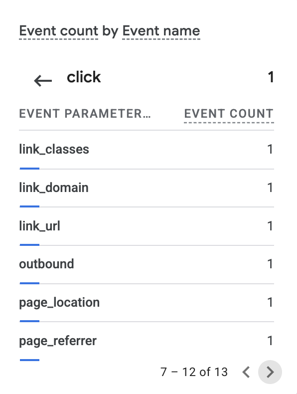

# Exercise 06 Evidence

## Email

Mail for `nickchabot.com` runs on Zoho Mail. I tested it on October 20, 2026, using a personal Gmail account as the outside mailbox.

| Test | Time (PDT) | Observed result | Authentication |
| --- | --- | --- | --- |
| Received a message ("Test 01: Inbound", outside mailbox to `nick@nickchabot.com`) | 10:52 AM | Arrived in the Zoho inbox. | **Not shown.** No Zoho headers saved for this message. |
| Replied to that message ("Re: Test 01: Inbound", `nick@nickchabot.com` to outside mailbox) | 10:54 AM | Arrived in the outside mailbox. | **Not shown.** No headers saved for the reply. |
| Sent a new message ("Test 04", sent by Claude Code through the Zoho MCP server) | 11:23 AM | Arrived in the outside mailbox with `nick@nickchabot.com` in From. | SPF: PASS with IP 165.173.182.52. DKIM: PASS with domain nickchabot.com. DMARC: PASS. |


*Gmail's authentication results for Test 04, sent from `nick@nickchabot.com` through the Zoho MCP server; the To address is redacted.*

### Authentication

The excerpt below is from the "Test 02: outbound" headers, as Gmail recorded them on arrival. The full headers are in [zoho-header-check.md](zoho-header-check.md).

```
Received: from sender6-of-o52.zoho.com (sender6-of-o52.zoho.com. [165.173.180.52]) by mx.google.com with ESMTPS ... Tue, 20 Oct 2026 10:55:53 -0700 (PDT)
Authentication-Results: mx.google.com;
       dkim=pass header.i=@nickchabot.com header.s=zmail header.b=oGZD7bug;
       spf=pass (google.com: domain of nick@nickchabot.com designates 165.173.180.52 as permitted sender) smtp.mailfrom=nick@nickchabot.com;
       dmarc=pass (p=NONE sp=NONE dis=NONE) header.from=nickchabot.com
```

| Check | Result | Domain |
| --- | --- | --- |
| SPF | pass | nickchabot.com |
| DKIM | pass (selector `zmail`) | nickchabot.com |
| DMARC | pass (policy `p=none`) | nickchabot.com |

DMARC passed because SPF and DKIM both passed for the same domain as the From address, `nickchabot.com`.

### Missing checks

- **Received test:** The 10:52 AM arrival time is recorded, but no screenshot of the Zoho inbox or Zoho's headers is saved to back it up.
- **Reply test:** The 10:54 AM arrival time is recorded, but no screenshot or authentication results from Gmail's "Show original" view are saved.
- **Test 04 arrival time:** The screenshot shows the authentication results but not the 11:23 AM arrival time.
- **Inbound authentication:** Nothing is saved yet showing how Zoho judged the incoming Gmail message (its `Authentication-Results: mx.zohomail.com` line).
- **Zoho admin console:** No screenshot yet of Zoho's own MX, SPF, and DKIM verification status under Domains > nickchabot.com > Email Configuration.

## GA4

The site is [nickchabot.com](https://nickchabot.com), and its [Privacy page](https://nickchabot.com/privacy) explains what Google Analytics collects and the visitor's cookie choice.

These events were captured from a local run of the site (`http://localhost:3000`), started at 12:58 PM PDT on October 20, 2026, with the screenshots taken at 1:01 PM. The live site couldn't be used because Railway was down and couldn't deploy. **The live-site check is pending.**


*GA4 recorded 3 `page_view` events, 1 `click`, and 1 `user_engagement` from the local run.*



*The `click` event carried `link_url`, `link_domain`, and `outbound` parameters, which GA4 attaches to clicks on links that leave the site.*

The click tells me a visitor followed a link from my site to another site; it doesn't tell me why they clicked or what they did once they got there.

### Missing checks

- **Live site:** These events come from localhost, not https://nickchabot.com. The live site still runs older code without the GA4 tag, and its Privacy page returns 404 until the new code is deployed.
- **Parameter values:** The click screenshot shows the parameter names, not their values. It doesn't show which `link_url` or `link_domain` was clicked, or that `outbound` was `true`. A screenshot of those values (for example, in GA4's DebugView) would confirm the outbound click.
- **Consent state:** Neither screenshot shows whether the cookie banner was accepted before these events were sent.
