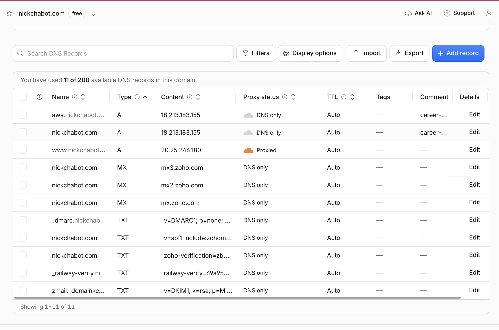
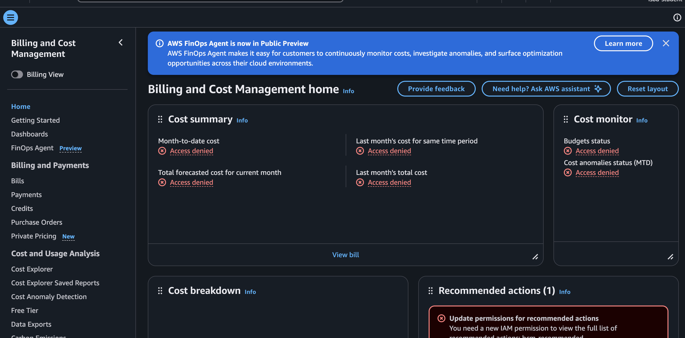

# Exercise 07 Evidence

The site moved from Railway to AWS: one EC2 instance and a Single-AZ RDS
PostgreSQL database in `us-east-1`. The architecture diagram is in the
[README](../../README.md#architecture). The full step-by-step record, with
every deviation from the plan, is in
[migration-notes.md](../../migration-notes.md).

## 1. Architecture decision

I chose **EC2 with a Single-AZ RDS PostgreSQL database**. I rejected
PostgreSQL on the same instance (about $8 a month cheaper, but I'd have to
manage its backups and upgrades) and Lambda with API Gateway (least to run,
but about $50–70 a month, and the app would need changes). The tradeoff I
accepted: paying about $12 a month for a database AWS backs up and patches,
while still running and patching the server myself, on a t3.micro whose
1 GiB of memory makes builds slow.

## 2. Backup record

| | |
| --- | --- |
| **Backup date** | 2026-10-29, 22:01 UTC: `pg_dump --format=custom` of the Railway PostgreSQL 18 database (25 KB, SHA-256 recorded). It's kept off-repo on my laptop and the server. |
| **Restore test** | **Passed.** Restored with `pg_restore --exit-on-error` into a throwaway PostgreSQL 18 container. All 14 tables matched live Railway exactly, checked by row count and an md5 of every row (`profile` 1, `project` 1, `education` 2, `experience` 2, `skill` 5, migrations 2, the other 8 tables 0). The same dump was restored into RDS on 2026-11-10 and matched again, table by table and row by row. |
| **No fresh dump at cutover** | Railway's database had been shut down since 2026-11-08, and its web service had been down since 2026-10-26. Nothing could have written to it after 10/29, so the 10/29 dump was the final state. Taking a fresh dump would have meant redeploying Railway, which I decided against. |
| **Data loss I accept** | **Up to 1 day.** RDS keeps automated backups with point-in-time restore for the last 24 hours. The account is on AWS's Free plan, which refused 7 days. A manual snapshot (`career-platform-after-cutover`) and the off-repo dump cover anything older. The content changes rarely, so a day's loss is acceptable. |
| **Recovery time I accept** | **Up to 4 hours.** That's enough to restore a snapshot or point in time to a new RDS instance, point the server at it and redeploy, or to rebuild the server from the plan. Measured so far: the 10/29 restore took seconds, a reboot recovers the site in 25 s, and a deploy takes 3–8 minutes. |

## 3. Verification on `aws.nickchabot.com`

Tested 2026-11-10, before the cutover, against the AWS copy only. The
complete table, with every command's output, is under "Step 10" in
[migration-notes.md](../../migration-notes.md#step-10-verification-on-awsnickchabotcom-2026-11-10-2010-2025-utc).

| What I tested | Evidence | Result |
| --- | --- | --- |
| DNS: `aws.nickchabot.com` resolves to the Elastic IP | `nslookup` on 1.1.1.1 and 8.8.8.8 both return the Elastic IP | Pass |
| HTTP redirects to HTTPS | `curl -I http://aws.nickchabot.com` returns `301` to `https://aws.nickchabot.com/`, keeping path and query | Pass |
| HTTPS works, with a valid certificate | `curl -I https://…` returns `200 OK` with HSTS. Let's Encrypt (YE1) certificate, expires 2027-02-08, verifies with code 0. Browser shows "Connection is secure" ([screenshot](aws-https-padlock.png)). | Pass |
| Certificate renews automatically | `sudo certbot renew --dry-run`: "all simulated renewals succeeded"; `certbot.timer` active | Pass |
| Data matches the backup | All 14 tables' row counts and per-row hashes match the restore-tested dump. The sample records (profile, project, both jobs, all 5 skills) show on the page. | Pass |
| Every main page loads | `/`, `/privacy`, `/login`, the project page, `/sitemap.xml` and `/api/health` return 200. Playwright: no console errors, no serious accessibility violations. All 18 internal links return 200. | Pass |
| A write to the database | Contact form: bad JSON gives 400, an invalid form gives 422 with nothing saved. A fake "AWS smoke test" message was saved (202), found in RDS by its id, then deleted. | Pass |
| Sign-in, `/admin`, resume upload, email alerts | `/admin` returns 500, because the Supabase and Resend settings aren't on the server yet | Not verified |
| RDS isn't reachable from the internet | `nc -vz <rds-endpoint> 5432` from my laptop times out. The endpoint is a private 172.31.x.x address, and `PubliclyAccessible` is false. | Pass |
| Firewall rules | 22 from my IP only; 80 and 443 public; no app port open; 5432 only from the web server's security group | Pass |
| No secrets in Git | No `.env`, dump, key or real password in any of the repo's 103 commits; checked against the actual values | Pass |
| Survives a reboot | After `aws ec2 reboot-instances`, the site came back on its own in 25 s, with every service enabled | Pass |
| Survives one app copy crashing | With one of the two copies stopped, 20 of 20 requests returned 200 | Pass |

**Not verified yet:** sign-in, `/admin`, resume upload and email alerts.
I chose to cut over before adding the Supabase and Resend values, because
nickchabot.com was already showing Railway's error page. Next step: put
the values in the server's settings file, redeploy, and test all four.

## 4. Cutover status

**Done: nickchabot.com moved to AWS on 2026-11-10 at 20:27 UTC (12:27 PT).**
Cloudflare's `@` record changed from a CNAME pointing at Railway to an
`A` record for the Elastic IP, DNS only. No other record changed, which a
full before-and-after comparison of every record confirms.

After the switch:
- `nslookup nickchabot.com` returns the Elastic IP from four resolvers.
- `http://` redirects to `https://`, which returns 200 with HSTS.
- The certificate was expanded to cover `nickchabot.com`.
- `www` still redirects to the bare domain.

Railway couldn't serve as the fallback during testing, as the exercise
intends: it had been down since 2026-10-26.

Cloudflare DNS for `nickchabot.com` after the cutover (2026-11-10, 12:57 PT).
Both `nickchabot.com` and `aws.nickchabot.com` are `A` records for the
Elastic IP, DNS only; `www` is still the proxied redirect. The browser's
address bar and the account sidebar are cropped out, because they show the
Cloudflare account ID and my email address.

## 5. Cost

**Estimate (section 6):** about **$26.82 a month**, from AWS's published
us-east-1 on-demand prices on 2026-11-10:

| Item | Price | Per month |
| --- | --- | --- |
| EC2 t3.micro | $0.0104/hr | $7.59 |
| RDS db.t4g.micro, Single-AZ | $0.016/hr | $11.68 |
| EC2 disk, 20 GB gp3 | $0.08/GB | $1.60 |
| RDS storage, 20 GB gp3 | $0.115/GB | $2.30 |
| Public IPv4 (Elastic IP) | $0.005/hr | $3.65 |
| RDS backups; data transfer under 100 GB | free | $0.00 |

**Billing page now:** **access denied for my course login.** AWS Billing
and Cost Management (2026-11-10, 12:59 PT), signed in as `isba-student`,
shows "Access denied" for month-to-date cost, forecast, last month's cost,
budgets and cost anomalies. The CLI gives the same result
(`budgets:ViewBudget`, `freetier:GetAccountPlanState` and
`pricing:GetProducts` are all denied).

So I can't see what has actually been billed. I'm recording this as an
account restriction, as the exercise allows, and will ask the instructor for
the account owner's figure. Two more facts about the account:
- It's on AWS's **Free plan**: RDS refused 7-day backups with
  `FreeTierRestrictionError`.
- The course policy limits EC2 to t3.micro and t3.small.

The account-number menu at the top of the screenshot is cropped out.

