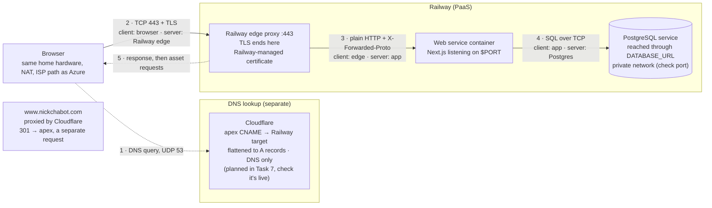

# Request Path: Entering nickchabot.com in a Browser

Assumptions: a new HTTPS connection over TCP, and a DNS lookup with no cached answer.

Items marked *check* aren't recorded in this repository. The Railway diagram shows the planned setup (Task 7 of `docs/superpowers/plans/2026-10-08-railway-postgres-migration.md`). As of 2026-10-20, DNS still pointed at the Azure VM and the Railway builds were failing (`docs/evidence/ex06.md`, `docs/evidence/dns-before-zoho.md`).

## Azure

```mermaid
flowchart LR
  subgraph HOME["Home network: devices and addresses from Ex01 (check)"]
    B["Browser on laptop<br/>Wi-Fi network interface<br/>DHCP gave: private IP, subnet,<br/>default gateway, DNS server"]
    AP["Access point<br/>Wi-Fi to wired"]
    SW["Switch<br/>delivers within the LAN"]
    R["Router = default gateway<br/>NAT: private → public address<br/>stateful firewall"]
    M["Modem / ONT"]
  end

  ISP["ISP network<br/>(details unknown)"]
  NET["Internet routers"]

  subgraph DNSX["DNS lookup: a separate exchange, not on the web path"]
    RES["Recursive resolver<br/>(router or ISP? check)"]
    CF["Cloudflare authoritative name servers<br/>gordon / margot.ns.cloudflare.com<br/>A nickchabot.com → VM public IP<br/>DNS only (grey cloud)"]
  end

  subgraph AZ["Azure, North Central US"]
    NSG["NSG vm-career-platformNSG<br/>allow 80, 443 from any<br/>allow 22 from laptop /32 only<br/>deny everything else"]
    subgraph VM["VM vm-career-platform · private IP 10.0.0.4"]
      NG["Nginx<br/>:80 → 301 to https<br/>:443 TLS ends here<br/>Let's Encrypt cert, Certbot timer"]
      A1["career-platform@8000<br/>Next.js on 127.0.0.1:8000"]
      A2["career-platform@8001<br/>Next.js on 127.0.0.1:8001"]
      DB[("SQLite file<br/>data/career_platform.db")]
    end
  end

  B -.->|"1 · DNS query, UDP 53<br/>client: laptop · server: resolver<br/>crosses the same LAN hardware"| RES
  RES -.->|"2 · asks the authoritative server"| CF
  CF -.->|"3 · answer: VM public IP"| B

  B -->|"4 · TCP to port 443, then TLS handshake<br/>client: browser · server: Nginx"| AP
  AP --> SW --> R
  R -->|"NAT rewrites source to home public IP"| M
  M --> ISP --> NET --> NSG
  NSG -->|"443 allowed"| NG
  NG -->|"5 · plain HTTP over loopback<br/>client: Nginx · server: app"| A1 & A2
  A1 & A2 -->|"6 · reads a local file, no network"| DB
  NG -.->|"7 · response returns the same path<br/>then CSS, JS, images as new requests"| B
```

## Railway

## What changes between the hosts

| | Azure | Railway |
|---|---|---|
| DNS answer | A record → the VM's public IP | CNAME, flattened to the A records of Railway's edge |
| Firewall | NSG rules that I manage | Railway decides what's exposed |
| Where TLS ends | Nginx on my VM; I run Certbot | Railway's edge; Railway manages the certificate |
| How the app is reached | Loopback `127.0.0.1:8000` and `:8001` | `$PORT` behind the proxy, so the app needs `X-Forwarded-Proto` (the reason for `076c39a`) |
| Database | A local SQLite file, with no network hop | A separate Postgres service, reached through `DATABASE_URL` |

## Sources

- `docs/how-this-site-is-secured.md`: where TLS ends, open ports, certificate, renewal
- `docs/superpowers/plans/2026-10-01-operate-the-vm.md`: Nginx, the @8000/@8001 services, private IP, NSG rules
- `docs/evidence/dns-before-zoho.md`: Cloudflare name servers and the DNS-only A records
- `docs/evidence/ex03.md`: VM region and size
- `docs/superpowers/plans/2026-10-08-railway-postgres-migration.md`: Railway edge, Postgres service, `www` redirect
